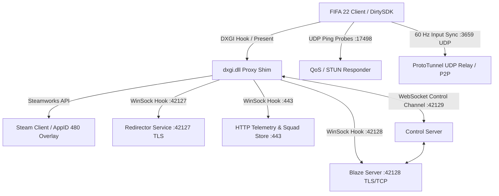

# FIFA 22 Clean-Room Multiplayer Emulator & Runtime Shim

[]()
[]()
[-orange.svg)]()
[-1b2838.svg)]()

A high-performance, clean-room educational multiplayer emulator and runtime proxy shim for **FIFA 22** (PC Retail Build `1.0.77.45722`, Frostbite 3 Engine).

This project restores peer-to-peer and relayed online multiplayer functionality without circumventing DRM or modifying original game binaries on disk.

---

## Architecture Overview



- **Redirector (`services-redirector`):** TLS-enabled redirector responding to `getServerInstance` on port `42127`.
- **Blaze Protocol Server (`services-blaze` & `emulator-server`):** Full-duplex RPC engine supporting `Util`, `Authentication`, `UserSessions`, `AssociationLists`, `GameManager` (v15/v16 TDF serialization), and `Stats`.
- **Content & Telemetry Sink (`services-http-content`):** Fast HTTP/200 telemetry sink for `river.data.ea.com` and canonical squad database distributor (`ATTR_SQDH` SHA-256 verification).
- **QoS & ProtoTunnel Relay (`services-qos-relay`):** DirtySDK `ProtoPing` / QoS responder on UDP port `17498` (reporting `OPEN` NAT status) and 60 Hz input frame relay on UDP port `3659`.
- **In-Game Overlay & Proxy Shim (`shim`):** Proxy `dxgi.dll` with MinHook, DirectX 11/12 Present hooks, Dear ImGui top-bar overlay, WinSock loopback redirects, and Steamworks (`AppID 480`) Shift+Tab overlay invite support.

---

## Prerequisites

1. **Rust Toolchain:** Stable Rust (1.80+ recommended) with `cargo`.
2. **C++ Toolchain:** CMake (3.20+), Ninja, and MinGW-w64 (GCC/Clang, e.g. WinLibs with LLVM).
3. **Steam:** Active Steam client running in the background for Steamworks P2P and friend invitations.
4. **Target Game:** FIFA 22 installed locally (e.g. `G:\Games\FIFA 22`).

---

## Building

### 1. Build the Rust Server Stack

From the repository root:
```bash
cargo build --release
```

To run the complete test suite (36 integration and unit tests):
```bash
cargo test --all
```

### 2. Compile the `dxgi.dll` Shim

Ensure MinGW / Clang and Ninja are in your system `PATH`, then build the shim:
```powershell
# Set MinGW compiler toolchain (adjust path to your local environment if needed)
$env:PATH = "C:\Users\$env:USERNAME\AppData\Local\Microsoft\WinGet\Packages\BrechtSanders.WinLibs.POSIX.MSVCRT.LLVM_Microsoft.Winget.Source_8wekyb3d8bbwe\mingw64\bin;$env:PATH"

# Configure & Build
cmake -B shim/build -S shim -G Ninja -DCMAKE_BUILD_TYPE=Release
cmake --build shim/build --config Release
```

The compiled proxy DLL will be located at `shim/build/dxgi.dll`.

---

## Deployment to FIFA 22

Use the automated PowerShell deployment script to deploy `dxgi.dll`, `steam_api64.dll`, and `steam_appid.txt` into your game installation directory:

```powershell
# Dry run check (verifies files and paths)
powershell -ExecutionPolicy Bypass -File .\tools\deploy_shim.ps1 -DryRun

# Install to game directory (G:\Games\FIFA 22)
powershell -ExecutionPolicy Bypass -File .\tools\deploy_shim.ps1 -Install
```

To uninstall and restore the original directory state:
```powershell
powershell -ExecutionPolicy Bypass -File .\tools\deploy_shim.ps1 -Uninstall
```

---

## Hosting & Playing a Match

### Step 1: Start the Emulator Server
Launch the backend services in release mode:
```powershell
cargo run --release -p emulator-server
```
The server will start all required listeners:
- Redirector: `0.0.0.0:42127` (TLS)
- Blaze Protocol: `0.0.0.0:42128` (TLS/Plain Dual Stream)
- HTTP Content & Telemetry: `0.0.0.0:443` & `0.0.0.0:80`
- QoS / STUN Responder: `0.0.0.0:17498` (UDP)
- ProtoTunnel Relay: `0.0.0.0:3659` (UDP)
- WebSocket Control Channel: `127.0.0.1:42129`

### Step 2: Launch FIFA 22
Ensure Steam is open and running on both players' machines, then launch `FIFA22.exe`.

### Step 3: Matchmaking Options

1. **Steam Shift+Tab Invitations (Recommended):**
   - Press **Shift+Tab** to open the Steam Overlay.
   - Right-click your friend playing **Spacewar** and select **Invite to Game**.
   - Your friend clicks **Join Game**, which automatically binds both clients to the same emulator match session.
2. **Native In-Game Matchmaking:**
   - Both players navigate to **Online Friendlies** or **Seasons** in the native FIFA 22 main menu.
   - The emulator's matchmaker pairs the players and initiates symmetric kickoff.
3. **Room Code Top-Bar Overlay:**
   - Press **F1** inside the game to toggle the ultra-minimal top-bar overlay.
   - Host generates a 6-character room code (e.g. `XY79K2`) or clicks **Create Room**.
   - Guest types the code and clicks **Join**.

### Step 4: Kickoff & Match Simulation
- Squad hashes are automatically verified (`ATTR_SQDH`).
- Deterministic 32-bit RNG seeds are shared (`ATTR_SEED`).
- DirtySDK synchronizes 60 Hz input frames via direct P2P UDP or through the `:3659` ProtoTunnel relay.
- The Netcode HUD displays live ping and frame sync status.
- At full-time or on match termination, statistics are ingested by the `Stats` component (`0x0007`) and session deallocation executes cleanly.

---

## Testing & Quality Assurance

All 36 tests across all 6 crates pass with 100% success:

```powershell
cargo test --all
```

Test coverage includes:
- **`blaze-core`:** Header framer, dual TLS/plain decoding, hex dump logging.
- **`blaze-tdf`:** 6-bit tag packing roundtrip, varint signed/unsigned, all 12 wire types.
- **`services-redirector`:** Redirection RPC responses.
- **`services-http-content`:** Telemetry sink, QoS XML endpoints, squad SHA-256 hash store.
- **`services-qos-relay`:** Async UDP QoS probe handling, ProtoTunnel packet forwarding.
- **`services-blaze`:** Association lists, Steam friends sync, symmetric kickoff state machine, deterministic RNG seed distribution, stats store leaderboard, session lifecycle.
- **Integration Tests:**
  - `boot_handshake.rs`: Full SSL redirection, login, and persona registration.
  - `lobby_matchmaking_flow.rs`: Native menu matchmaking, Room Code API, and Steam overlay join.
  - `match_kickoff_flow.rs`: 60 Hz input replication and pre-kickoff state machine.
  - `online_hub_flow.rs`: Two-player hub synchronization.
  - `disconnect_flow.rs`: Abrupt disconnect recovery, keep-alive monitor, and peer cleanup.

---

## Legal & Compliance Notice

This project is developed solely for **educational, historical preservation, and interoperability research** purposes under reverse-engineering exceptions provided by copyright law. 
- It does **not** bypass, decrypt, or alter EA's Denuvo or Origin entitlement protections.
- It contains **no proprietary EA game binaries or copyrighted assets**.
- Game clients must be legally purchased and owned by the end users.
