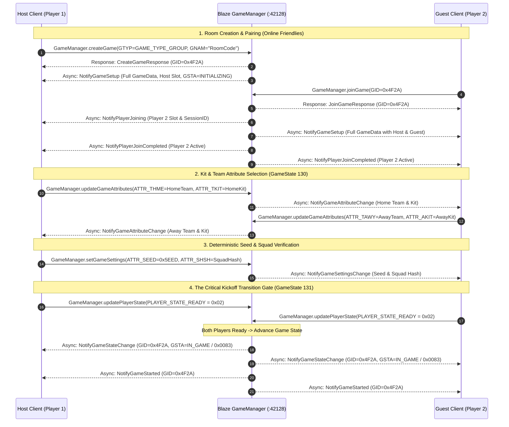

# Execution Plan: Live Runtime Validation, State-Machine Synchronization, and 60 Hz Match Transport

**Document Version:** 1.0.0  
**Target Milestone:** Transition from Codebase Verification (Milestones 0–6) to Live Match Kickoff  
**Game Target:** EA Sports FIFA 22 (Frostbite 3 Engine, PC Retail `1.0.77.45722`)  
**Key References:** Lessons learned from FIFA 16/17 community revival projects, EA DirtySDK 15.1.7, and EA Blaze Protocol 15.1.1  

---

## Executive Summary & Strategic Focus

Our engineering foundation (Milestones 0–6) has established clean-room protocol codecs (`blaze-tdf`, `blaze-core`), backend microservices (`services-redirector`, `services-blaze`, `services-qos-relay`, `services-http-content`), and the C++ runtime injection shim (`shim/dxgi.dll`). 

Drawing direct lessons from community reverse engineering of Frostbite sports titles (FIFA 16, 17, and Frostbite 3 network engines), the primary barrier to a working match is **not** encryption, certificate verification, or network injection—those gates are already cleared. Instead, the critical path is:
1. **Live Runtime Smoke Testing & Shim Interception Validation.**
2. **De-risking the State-Machine Deadlock** between Kit Selection (`GameState 130`) and Match Kick-off (`GameState 131`).
3. **Establishing Low-Latency 60 Hz Deterministic UDP Simulation Sync** over direct P2P or ProtoTunnel relay.

```
+-------------------------------------------------------------------------------------------------------+
|                                    STAGE 1: LIVE RUNTIME SMOKE TESTING                                |
|   - Spin up local Rust backend stack (Redirector, Core Blaze, Control API, QoS, Telemetry, Relay)     |
|   - Validate dxgi.dll shim attachment, MinHook WinSock detours, and DX11/12 ImGui top-bar (F1)        |
+-------------------------------------------------------------------------------------------------------+
                                                   |
                                                   v
+-------------------------------------------------------------------------------------------------------+
|                              STAGE 2: DE-RISKING STATE-MACHINE DEADLOCK                               |
|   - Dissect and capture loopback packets with Wireshark Lua dissector (blaze.lua)                    |
|   - Resolve the Notification Sequence Trap: order-sensitive async push pipeline via tokio::sync::mpsc |
|   - Bridge Kit Selection (GameState 130) -> Match Kick-off (GameState 131) via symmetric notifications|
+-------------------------------------------------------------------------------------------------------+
                                                   |
                                                   v
+-------------------------------------------------------------------------------------------------------+
|                              STAGE 3: TWO-PLAYER 60 HZ UDP TRANSPORT SYNC                             |
|   - Validate Three-Tier Transport: Direct P2P -> ProtoTunnel Relay (:3659) -> Steam SDR               |
|   - Monitor Netcode HUD (F2): RTT < 50ms, jitter buffer, NetGameDist deterministic frame advancing    |
+-------------------------------------------------------------------------------------------------------+
```

---

## Stage 1: Live Runtime Smoke Testing & Shim Validation

### 1.1 Local Backend Stack Initialization
The full emulator stack must be operational locally before game launch. All listeners bind to `0.0.0.0` with dual IPv4/IPv6 support:

| Service Component | Port / Transport | Role in FIFA 22 Lifecycle | Status |
| :--- | :--- | :--- | :--- |
| **Blaze Redirector** | TCP `42230` & `42127` (TLS) | Resolves `spring18.gosredirector.ea.com` to target instance | Verified (HTTP 200 + XML) |
| **Core Blaze Server** | TCP `42128` (Dual TLS/Plain) | Authentication, UserSessions, GameManager, Rooms | Verified (`standardSecure_v4`) |
| **Control REST API** | HTTP `42129` (Plain) | Syncs Steam persona, Room Codes, and live UI with `dxgi.dll` | Active & Polling |
| **Telemetry Sink** | HTTPS `443` (TLS) | Absorbs `river.data.ea.com` HTTP PIN events without error | Active |
| **DirtySDK QoS / STUN** | UDP `17498` | ProtoPing latency diagnostic probe for NAT discovery | Active |
| **ProtoTunnel Relay** | UDP `3659` | Relays 60 Hz game packets for symmetric NAT / CGNAT clients | Active |

**Operational Command:**
```powershell
# From project root
.\start_all.bat
# Or run release daemon directly:
target\release\emulator-server.exe
```

### 1.2 Shim Attachment & Runtime Log Inspection
Upon launching `G:\Games\FIFA 22\FIFA22.exe`, inspect `G:\Games\FIFA 22\f22_shim.log` to confirm the proxy loader and detours initialized correctly:

1. **WinSock Hook Verification:**
   - Confirm detours on `connect`, `WSAConnect`, `getaddrinfo`, and `WSAIoctl(SIO_GET_EXTENSION_FUNCTION_POINTER)` for `ConnectEx`.
   - Confirm IPv4 (`AF_INET`) and dual-stack IPv6 (`[::ffff:127.0.0.1]`) rerouting for `42230`, `42128`, and `443`.
   - Confirm passthrough on `127.0.0.1:42129` (Control Channel).
2. **In-Memory DigiCert CA Modulus Patch:**
   - Confirm scan for DirtySDK's embedded DigiCert 256-byte public modulus succeeds in RAM without modifying `FIFA22.exe` on disk.
3. **DirectX SwapChain & ImGui Overlay:**
   - Confirm DX11 (`dxgi.dll` -> `D3D11CreateDeviceAndSwapChain`) or DX12 (`CreateCommandQueue` / `Present1`) hook registration.
   - Press **F1**: Confirm the top-bar overlay renders over the FIFA 22 menu showing:
     - Steam persona and avatar.
     - Connection status indicator (Green = Connected to `:42128` / `:42129`).
     - Room Code Generator and input text box.
   - Press **F2**: Confirm the Netcode Diagnostic Pill HUD toggles cleanly without crashing the render loop.

---

## Stage 2: De-Risking the Phase 3 State-Machine Deadlock

### 2.1 The "Notification Sequence Trap" (Lessons from FIFA 16/17)
In retail Frostbite sports titles, the transition from **Kit Selection** (`GameState 130` / `PRE_MATCH`) to **Match Kickoff** (`GameState 131` / `IN_GAME`) is the most fragile state machine in the engine:
* **Passive Client Architecture:** Retail clients do not proactively send a "Ready" RPC to start the match. They wait passively for the Blaze server to push an exact, order-dependent sequence of asynchronous notifications.
* **Deadlock Condition:** If the server fails to dispatch notifications in the exact order, or omits a required TDF attribute, both clients remain frozen on the kit selection / loading arena screen, waiting for the other peer. Eventually, DirtySDK's 30-second socket watchdog fires and displays *"Your opponent has left the match"*.

### 2.2 The Exact Notification Sequence Pipeline
To clear the synchronization gate into kickoff, `services-blaze::gamemanager` must execute the following sequence via the asynchronous `tokio::sync::mpsc` notification channel:



### 2.3 Diagnostic Tooling & Dissection Action Items
1. **Wireshark Live Loopback Dissection:**
   - Load `tools/dissector/blaze.lua` in Wireshark (`Help -> About Wireshark -> Plugins -> Personal Lua Plugins`).
   - Capture interface: `\Device\NPF_Loopback` (Adapter for loopback traffic).
   - Display Filter: `blaze && (tcp.port == 42128 || tcp.port == 42230)`.
   - Inspect every packet header (`Component`, `Command`, `SeqNo`, `MsgType`) and payload TDF tags.
2. **Wildcard `ERR_OK` Trap & Logging:**
   - In `services-blaze/src/router.rs`, the wildcard handler logs unknown RPCs:
     ```rust
     tracing::info!("[Blaze Router] Wildcard Auto-OK -> Component 0x{:04X}, Command 0x{:04X}, Seq={}, PayloadKeys={:?}", comp, cmd, req.header.seq_no, req.payload.fields.keys());
     ```
   - Any unhandled RPC logged during kit selection must be implemented with its exact response schema to prevent the client from waiting for a missing response.
3. **Dedicated Unit & Flow Verification:**
   - Expand `crates/emulator-server/tests/match_kickoff_flow.rs` to assert that `NotifyGameStateChange(IN_GAME)` and `NotifyGameStarted` arrive synchronously on both notification channels.

---

## Stage 3: Validating Two-Player 60 Hz UDP Transport

### 3.1 Three-Tier Transport Routing Architecture
Once the Frostbite engine transitions into `GameState 131`, simulation responsibility shifts from TCP Blaze signaling to UDP transport on port `3659`:

```
                           +---------------------------+
                           |  FIFA 22 Local Simulation |
                           +-------------+-------------+
                                         |
                                         v
                         [ Transport Dispatcher: Port 3659 ]
                                         |
            +----------------------------+----------------------------+
            | (Open / Moderate NAT)      | (Symmetric / CGNAT)        | (Steam SDR Mesh)
            v                            v                            v
   +-----------------+          +-----------------+          +-----------------+
   | Tier 1: Direct  |          | Tier 2: Relay   |          | Tier 3: Steam   |
   | P2P (CommUDP)   |          | (ProtoTunnel)   |          | SDR P2P Relay   |
   | < 20ms Latency  |          | UDP Port 3659   |          | Steam Sockets   |
   +--------+--------+          +--------+--------+          +--------+--------+
            |                            |                            |
            +----------------------------+----------------------------+
                                         |
                                         v
                           +---------------------------+
                           | Remote Opponent Simulation|
                           +---------------------------+
```

1. **Tier 1: Direct P2P (`CommUDP`)**
   - Utilizes STUN reflection data from our QoS service (`:17498`) exchanged via `UserSessions.updateNetworkInfo`.
   - Preferred for low-latency LAN and WAN connections with UPnP or port-forwarded routers.
2. **Tier 2: Clean-Room ProtoTunnel UDP Relay (`services-qos-relay::relay`)**
   - Fallback when direct STUN punching fails due to symmetric or carrier-grade NAT.
   - Encapsulates DirtySDK NetGameDist frames in ProtoTunnel headers (`0x00000000` session tag) and forwards them bi-directionally on UDP `:3659`.
3. **Tier 3: Steam Networking Sockets (`ISteamNetworkingSockets`)**
   - Out-of-band P2P bridge provided by `shim/src/steam_bridge.cpp`.
   - Routes packets across Valve's Steam Datagram Relay (SDR) network using the active Steam session.

### 3.2 Netcode HUD Monitoring & Deterministic Input Sync (F2)
During match execution, monitor the in-game HUD (Hotkey **F2**) to verify simulation stability:
* **Round-Trip Time (RTT):** Verified below 50ms on local/LAN connections.
* **Jitter & Frame Deviation:** Ensure jitter remains under 5ms to avoid input lag spikes.
* **Deterministic Lockstep Frame Sync:** 
  - FIFA 22 simulation runs at 60 Hz (16.66ms tickrate).
  - Both instances exchange controller input vectors and advance the physics simulation in lockstep.
  - Squad SHA-256 hash (`ATTR_SHSH`) and match seed (`ATTR_SEED`) must match identically to guarantee deterministic physics calculation without out-of-sync (OOS) errors.

---

## Detailed Task Breakdown & Ownership Matrix

| Phase | Task ID | Work Item | Verification Criteria | Target File / Module |
| :--- | :--- | :--- | :--- | :--- |
| **Stage 1** | `T1.1` | Verify dual listener TLS redirect | Client connects to `:42128` over TLS when `standardSecure_v4` requested | `crates/emulator-server/src/redirector_server.rs` |
| **Stage 1** | `T1.2` | Confirm `dxgi.dll` runtime attach | `f22_shim.log` shows clean MinHook & ConnectEx detours without errors | `G:\Games\FIFA 22\f22_shim.log` |
| **Stage 1** | `T1.3` | Test F1 ImGui top-bar menu overlay | F1 toggles Steam identity, room code input, and server status pill | `shim/src/overlay/imgui_overlay.cpp` |
| **Stage 2** | `T2.1` | Capture loopback traffic in Wireshark | `blaze.lua` dissects all RPCs and async notifications on `:42128` | `tools/dissector/blaze.lua` |
| **Stage 2** | `T2.2` | Log unknown RPCs during kit selection | Zero unhandled RPCs stall the client during kit selection | `crates/services-blaze/src/router.rs` |
| **Stage 2** | `T2.3` | Implement symmetric player state ready | Dispatch `NotifyGameStateChange(IN_GAME)` when both players mark ready | `crates/services-blaze/src/gamemanager.rs` |
| **Stage 2** | `T2.4` | Eliminate kit-selection deadlock | Client transitions from loading arena into stadium pitch | Integration test: `match_kickoff_flow.rs` |
| **Stage 3** | `T3.1` | Benchmark ProtoTunnel UDP relay | Bi-directional packet replication verified on port 3659 | `crates/services-qos-relay/src/relay.rs` |
| **Stage 3** | `T3.2` | Validate F2 Netcode HUD pill | Live RTT, jitter, and frame sync rendered in-game | `shim/src/overlay/netcode_hud.cpp` |
| **Stage 3** | `T3.3` | Verify two-player match kickoff | 90-minute simulation runs without out-of-sync or disconnect | Two-client loopback verification |

---

## Immediate Next Actions

1. **Keep Emulator Daemon Active:** `target\release\emulator-server.exe` running locally with the commit `c8c6557` (secure TLS redirect and `X-BLAZE-ERRORCODE: 0` headers).
2. **Execute In-Game Smoke Test:** Click **Online Friendlies** in FIFA 22 to confirm the client proceeds past redirector resolution into `Util::preAuth` and `Authentication::expressLogin`.
3. **Capture & Inspect Trace:** Use `tools/dissector/blaze.lua` in Wireshark to verify the exact RPC flow, capturing any missing notification gates between kit selection and kickoff.
