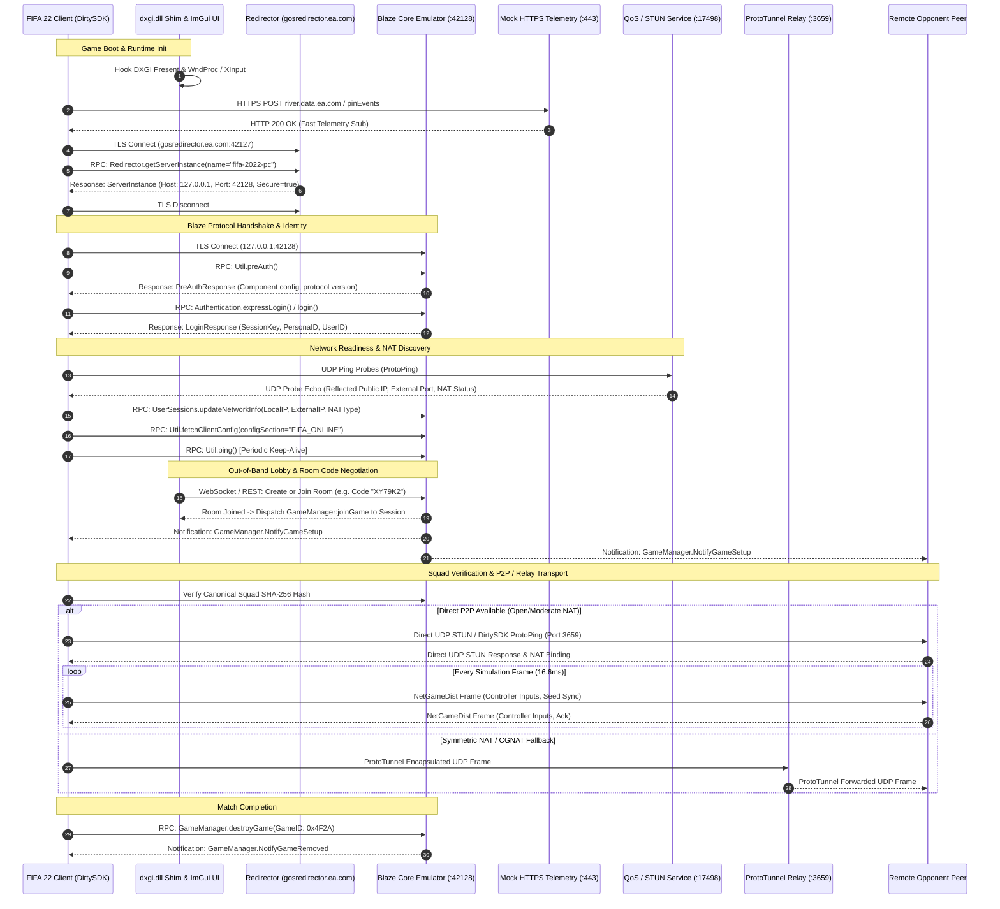

# EA Frostbite 3 / FIFA 22 Multiplayer Emulator Architecture & Implementation Roadmap

**Target Game:** FIFA 22 (PC Retail Build `1.0.77.45722`, Engine: Frostbite 3)  
**Game Installation Root:** `G:\Games\FIFA 22`  
**Networking Framework:** EA DirtySDK (v15/v16) + EA Blaze Protocol (RPC over TLS / TDF Serialization)  
**Target Architecture:** Clean-Room Protocol Server, P2P/Relay Coordinator, & In-Game ImGui Overlay  
**Document Classification:** Architectural Specification & Implementation Roadmap  
**Status:** Living Engineering Blueprint (`docs/MULTIPLAYER_ROADMAP.md`)

---

## 1. Executive Summary & Clean-Room Mandate

### 1.1 Objective & Scope
The objective of this project is to develop an educational, clean-room server emulator and companion runtime shim capable of orchestrating online multiplayer sessions for **FIFA 22** on PC. 

Unlike Battlefield 4 (which requires a 64-player authoritative headless dedicated server `Server.exe`), FIFA 22 employs a **hybrid architecture**:
1. **Control & Signaling Plane:** Centralized RPC server (EA Blaze protocol) running over TLS for authentication, matchmaking, user personas, catalog queries, and lobby orchestration.
2. **QoS & Relay Infrastructure:** Dedicated QoS/STUN responder and fallback UDP Relay (`ProtoTunnel`) for players restricted by Carrier-Grade NAT (CGNAT) or Symmetric NAT.
3. **Data & Simulation Plane:** Direct Peer-to-Peer (P2P) mesh or relayed transport utilizing EA DirtySDK (`CommUDP`, `NetGameDist`, and `ProtoTunnel`) where two or more clients exchange deterministic input frames.
4. **Client-Side In-Game Overlay:** A DirectX 11 / DirectX 12 Dear ImGui interface injected via a proxy `dxgi.dll` providing room codes, a custom lobby browser, netcode telemetry HUD, and a live Blaze RPC inspector—bypassing the defunct Origin Friends/XMPP service.

### 1.2 Clean-Room & Legal Constraints
To ensure strictly lawful, clean-room reverse engineering and interoperability:
- **Zero DRM Circumvention:** The emulator operates exclusively as an external network endpoint. It does not tamper with, de-virtualize, or patch Denuvo Anti-Tamper or EA Origin/EA Desktop entitlement checks on disk.
- **Protocol Re-implementation Only:** All Blaze schemas, Tagged Data Format (TDF) serializers, and DirtySDK packet framing are implemented from clean-room behavioral observations, network traffic captures, and open-source protocol specifications.
- **Non-Invasive Interception:** Traffic is rerouted via standard OS network routing (DNS / loopback proxy) and runtime dynamic library wrapping (`dxgi.dll` proxy forwarding), leaving the installed game binaries in `G:\Games\FIFA 22` unaltered.

---

## 2. System Topology & Component Model

### 2.1 Frostbite 3 Topology Comparison: Battlefield 4 vs. FIFA 22

| Architectural Dimension | Battlefield 4 (Frostbite 3 Shooter) | FIFA 22 (Frostbite 3 Sports Simulation) |
| :--- | :--- | :--- |
| **Session Model** | Client-Server (Dedicated Server Mesh) | Hybrid P2P / Client-Relay Mesh |
| **Simulation Host** | Headless Dedicated Server (`Server.exe`) | Designated Host Client or `ProtoTunnel` Relay Endpoint |
| **Player Count** | High concurrency (32 to 64+ players) | Low concurrency (1v1, 2v2, Co-Op, up to 11v11 Clubs) |
| **Tickrate & Transport** | 30 Hz - 60 Hz - 120 Hz UDP Client-Server | 60 Hz Deterministic Lockstep / Input Sync via UDP |
| **Physics & Destruction** | Server-authoritative physics & Levolution sync | Client-synchronized local physics & animation blend |
| **Blaze Role** | Server browser, stats, license auth, backend RPC | Matchmaking, lobby lifecycle, STUN/NAT broker, squad sync |
| **Transport Layer** | Frostbite Network Dispatcher over UDP | DirtySDK `CommUDP` / `NetGameDist` / `ProtoTunnel` |

### 2.2 End-to-End Client Lifecycle (Sequence Diagram)



---

## 3. Protocol Engine & Serialization

### 3.1 Blaze Framing & Wire Format
Traffic between the client and the Blaze server consists of framed binary messages. Each message starts with a fixed-size header followed by a variable-length Tagged Data Format (TDF) payload.

#### 3.1.1 12-Byte Blaze Header Layout
```text
 0                   1                   2                   3
 0 1 2 3 4 5 6 7 8 9 0 1 2 3 4 5 6 7 8 9 0 1 2 3 4 5 6 7 8 9 0 1
+-+-+-+-+-+-+-+-+-+-+-+-+-+-+-+-+-+-+-+-+-+-+-+-+-+-+-+-+-+-+-+-+
|                   Payload Length (24 bits)                    |
+-+-+-+-+-+-+-+-+-+-+-+-+-+-+-+-+-+-+-+-+-+-+-+-+-+-+-+-+-+-+-+-+
|        Component ID (16 bits)         |         Command ID (16 bits)  |
+-+-+-+-+-+-+-+-+-+-+-+-+-+-+-+-+-+-+-+-+-+-+-+-+-+-+-+-+-+-+-+-+
|        Error Code (16 bits)           | MsgType (4b) | QoS/Ctx (4b)   |
+-+-+-+-+-+-+-+-+-+-+-+-+-+-+-+-+-+-+-+-+-+-+-+-+-+-+-+-+-+-+-+-+
|  Reserved (8) |            Transaction / Sequence ID (16/32 bits)     |
+-+-+-+-+-+-+-+-+-+-+-+-+-+-+-+-+-+-+-+-+-+-+-+-+-+-+-+-+-+-+-+-+
```

* **Payload Length (24-bit uint BE):** Total byte length of the following TDF payload (excluding the 12-byte header).
* **Component ID (16-bit uint BE):** The functional Blaze service (e.g., `0x0001` = Authentication, `0x0004` = GameManager).
* **Command ID (16-bit uint BE):** The RPC operation code within the component (e.g., `0x0001` = `createGame`).
* **Error Code (16-bit uint BE):** `0x0000` for success (`ERR_OK`), or specific Blaze error codes.
* **Message Type (4 bits):**
  - `0x0` = `SUBMIT_REQUEST` (Client-to-Server RPC)
  - `0x1` = `RECORD_RESPONSE` (Server-to-Client RPC response)
  - `0x2` = `NOTIFICATION` (Server-to-Client unsolicited async event)
  - `0x3` = `ERROR_RESPONSE` (Server-to-Client RPC failure response)
* **Transaction ID (16/32 bits):** Correlation identifier matching a client request to its corresponding server response.

---

### 3.2 Tagged Data Format (TDF) Engine

#### 3.2.1 The 6-Bit Tag Encoding/Decoding Algorithm
In Blaze TDF, struct field names are encoded into a compact 3-byte (24-bit) integer using a **6-bit character compression algorithm**. Field names consist of 1 to 4 ASCII characters (uppercase A-Z, digits 0-9, and selected symbols).

> [!IMPORTANT]
> **Why Naive 7-Bit Masking Fails:**  
> Shifting 7-bit numbers (`0x7F`) by 6 bits causes bit 6 of each character to overlap with bit 0 of the adjacent character, corrupting the tag integer.  
> The correct EA Blaze implementation compresses each character into **exactly 6 bits** ($2^6 = 64$ possible values), allowing 4 characters to pack perfectly into 24 bits ($4 \times 6 = 24$) with **zero bit collision**.

##### Character to 6-Bit Mapping
Blaze splits characters into two primary domains using ASCII bit 5 (`0x20`):
1. **Uppercase Letters & High Symbols (`c & 0x20 == 0`):** ASCII `'A'` is `0x41` (`0b01000001`). Bit 5 is 0. Blaze sets bit 5 of the 6-bit chunk: `0x20 | (c & 0x1F)`. Thus, `'A'` becomes `0x21` (`0b100001` = 33).
2. **Digits & Low Symbols (`c & 0x20 != 0`):** ASCII `'0'` is `0x30` (`0b00110000`). Bit 5 is 1. Blaze clears bit 5 of the 6-bit chunk: `c & 0x1F`. Thus, `'0'` becomes `0x10` (`0b010000` = 16).
3. **Null / Padding:** A byte value of `0` maps to `0x00`.

##### Complete Rust Implementation
```rust
/// Encodes an ASCII byte into a 6-bit Blaze character chunk (0..=63).
#[inline]
fn char_to_6bit(c: u8) -> u32 {
    if c == 0 {
        0
    } else if (c & 0x20) == 0 {
        // Uppercase ASCII letter or symbol ('A'-'Z', '@', etc.)
        0x20 | ((c as u32) & 0x1F)
    } else {
        // Digit or symbol ('0'-'9', '_', etc.)
        (c as u32) & 0x1F
    }
}

/// Decodes a 6-bit Blaze character chunk back into an ASCII char.
#[inline]
fn sixbit_to_char(p: u32) -> Option<char> {
    let p = p & 0x3F;
    if p == 0 {
        None
    } else if (p & 0x20) != 0 {
        // Bit 5 set: reconstruct uppercase letter (ASCII bit 6=1, bit 5=0)
        Some((((p & 0x1F) | 0x40) as u8) as char)
    } else {
        // Bit 5 clear: reconstruct digit/symbol (ASCII bit 6=0, bit 5=1)
        Some((((p & 0x1F) | 0x20) as u8) as char)
    }
}

/// Encodes a 1-to-4 character ASCII tag into a 24-bit Blaze tag integer.
pub fn encode_tdf_tag(tag_str: &str) -> u32 {
    let mut bytes = [0u8; 4];
    for (i, b) in tag_str.as_bytes().iter().take(4).enumerate() {
        bytes[i] = *b;
    }
    
    let p0 = char_to_6bit(bytes[0]);
    let p1 = char_to_6bit(bytes[1]);
    let p2 = char_to_6bit(bytes[2]);
    let p3 = char_to_6bit(bytes[3]);

    // Pack 4 x 6-bit values into exactly 24 bits
    (p0 << 18) | (p1 << 12) | (p2 << 6) | p3
}

/// Decodes a 24-bit Blaze tag integer back into an ASCII string.
pub fn decode_tdf_tag(tag: u32) -> String {
    let p0 = (tag >> 18) & 0x3F;
    let p1 = (tag >> 12) & 0x3F;
    let p2 = (tag >> 6) & 0x3F;
    let p3 = tag & 0x3F;

    let mut result = String::with_capacity(4);
    for p in [p0, p1, p2, p3] {
        if let Some(ch) = sixbit_to_char(p) {
            result.push(ch);
        }
    }
    result
}

#[cfg(test)]
mod tests {
    use super::*;

    #[test]
    fn test_tag_roundtrip() {
        let test_tags = ["GNAM", "GTYP", "GSET", "ATTR", "DATA", "SEED", "ID", "A", "0001"];
        for tag in test_tags {
            let encoded = encode_tdf_tag(tag);
            assert!(encoded <= 0x00FF_FFFF, "Tag must fit within 24 bits");
            let decoded = decode_tdf_tag(encoded);
            assert_eq!(tag, decoded, "Tag round-trip failed for {}", tag);
        }
    }
}
```

#### 3.2.2 TDF Type System Specification
Each TDF field starts with the 3-byte Tag followed by a 1-byte Type ID:

| Type ID | Type Name | Wire Encoding Description |
| :--- | :--- | :--- |
| `0x00` | **INTEGER / VARINT** | Compressed variable-length integer (1 to 8 bytes, MSB indicates continuation). |
| `0x01` | **STRING** | Variable-length integer string length + UTF-8 payload (includes null byte). |
| `0x02` | **BLOB / BINARY** | Variable-length integer byte length + raw binary payload. |
| `0x03` | **STRUCT** | Nested list of Tagged fields, terminated by single null byte (`0x00` / `TAG_END`). |
| `0x04` | **LIST** | 1-byte element type + VarInt element count + sequential element values. |
| `0x05` | **MAP** | 1-byte key type + 1-byte value type + VarInt pair count + sequential key-value pairs. |
| `0x06` | **UNION** | 1-byte active member indicator (`0xFF` = empty) + active Tag + inner field. |
| `0x07` | **VARIABLE INTEGER** | 64-bit integer encoded with standard VarInt compression. |
| `0x08` | **OBJECT ID** | BlazeObjectType (16-bit component + 16-bit type) + 64-bit BlazeId. |
| `0x09` | **OBJECT TYPE** | 16-bit component ID + 16-bit sub-type ID. |
| `0x0A` | **TIME VALUE** | 64-bit signed integer (microseconds elapsed since Unix epoch). |
| `0x0B` | **FLOAT** | 32-bit standard IEEE 754 floating point number (big-endian). |

### 3.3 Core Blaze Component & Command Definition Map (FIFA 22)

```text
+------------------------------------------------------------------------------------+
| Component: REDIRECTOR (0x0005)                                                     |
+------------------------------------------------------------------------------------+
| 0x0001 | getServerInstance   | Resolves target Blaze cluster endpoint & TLS specs.  |
+------------------------------------------------------------------------------------+

+------------------------------------------------------------------------------------+
| Component: AUTHENTICATION (0x0001)                                                 |
+------------------------------------------------------------------------------------+
| 0x001C | expressLogin        | Token/origin authentication; returns SessionKey.     |
| 0x0028 | login               | Standard credential/persona login.                   |
| 0x0029 | silentLogin         | Re-login utilizing existing token session.           |
| 0x0046 | listUserEntitlements| Fetches persona game entitlements and DLC access.    |
+------------------------------------------------------------------------------------+

+------------------------------------------------------------------------------------+
| Component: UTIL (0x0009)                                                           |
+------------------------------------------------------------------------------------+
| 0x0001 | fetchClientConfig   | Fetches client XML/INI configurations from server.   |
| 0x0002 | ping                | Heartbeat keep-alive; responds with server time.     |
| 0x0003 | setClientData       | Client reporting hardware info, locale, and version. |
| 0x0007 | preAuth             | Handshake returning Blaze cluster feature flags.     |
| 0x0008 | postAuth            | Finalizes client initialization sequence.            |
| 0x000A | userSettingsLoad    | Retrieves persisted user settings.                   |
| 0x000B | userSettingsSave    | Persists user controller & camera profiles to cloud. |
| 0x000C | userSettingsLoadAll | Retrieves every persisted user setting.              |
+------------------------------------------------------------------------------------+

+------------------------------------------------------------------------------------+
| Component: USERSESSIONS / USERS (0x7802 / 0x0019)                                  |
+------------------------------------------------------------------------------------+
| 0x0003 | lookupUsers         | Resolves EA persona names and IDs.                   |
| 0x0008 | updateNetworkInfo   | Client reports internal IP, external IP, & NAT type. |
| 0x0014 | updateClientData    | Updates telemetry metrics and gameplay mode info.    |
| Async  | UserSessionExtended | Server broadcast of player status and network flags. |
+------------------------------------------------------------------------------------+

+------------------------------------------------------------------------------------+
| Component: GAMEMANAGER (0x0004)                                                    |
+------------------------------------------------------------------------------------+
| 0x0001 | createGame          | Client requests creation of a new virtual match.     |
| 0x0002 | destroyGame         | Closes match and deallocates game session ID.        |
| 0x0004 | joinGame            | Client joins an existing match via invitation or ID. |
| 0x0007 | startMatchmaking    | Places client into matchmaking queue for peer search.|
| 0x0008 | cancelMatchmaking   | Removes client from matchmaking queue.               |
| 0x000B | finalizeGameCreation| Signals host peer is ready for client connections.   |
| 0x000C | setGameSettings     | Configures joinable state, visibility, and topology. |
| 0x0014 | updatePlayerState   | State updates: CONNECTED, PRE_GAME, IN_GAME.         |
| 0x0016 | updateGameAttributes| Synchronizes kits, squads, seed, and match duration. |
| Async  | NotifyGameCreated   | Broadcast to host with assigned GameID.              |
| Async  | NotifyGameSetup     | Broadcast to joiner with host IP/port and topology.  |
| Async  | NotifyPlayerJoining | Broadcast to lobby when a new peer attempts connect. |
| Async  | NotifyPlayerState   | Broadcast when peer enters match kickoff state.      |
+------------------------------------------------------------------------------------+
```

---

## 4. Traffic Redirection, Network Shim & Telemetry Sink

### 4.1 Target Binary Landscape (`G:\Games\FIFA 22`)
Inspection of the game installation directory reveals:
- **`FIFA22.exe` (592 MB):** The primary 64-bit Frostbite 3 runtime executable. The executable is protected by Denuvo Anti-Tamper (`anadius.cfg` records `DenuvoToken`, `DenuvoExeHash`, and `DenuvoDllHash`).
- **`fifa22hook.log`:** Confirms prior dynamic instrumentation verifying that network operations pass through WinSock `connect()`.
- **Bundled Network & Support DLLs:**
  - `sysdll_Win64_retail.dll`: Native threading and runtime synchronization wrapper.
  - `EAWebKit.dll`: Embedded browser engine for web-based UI flows (Terms of Service, Origin/EA Overlay).
  - `oo2core_8_win64.dll`: Oodle compression engine used for decompressing `initfs_Win32` and superbundle layouts.
  - `Core/Activation64.dll`: Origin platform activation layer.

> [!CAUTION]
> **No Static Binary Modification:** Directly patching `FIFA22.exe` on disk will invalidate Denuvo binary hashes and cause immediate launch termination. All traffic rerouting and certificate validation adjustments must be performed dynamically in memory or at the network socket layer.

### 4.2 Dynamic Library Proxy Shim (`dxgi.dll`)
We deploy a proxy `dxgi.dll` in `G:\Games\FIFA 22`. When `FIFA22.exe` loads, the OS dynamic linker loads our proxy instead of the system library:
1. **Export Forwarding:** Forwards all standard DXGI exports (`CreateDXGIFactory`, `CreateDXGIFactory1`, `CreateDXGIFactory2`, etc.) to `C:\Windows\System32\dxgi.dll`.
2. **WinSock Interception:** Hooks `connect`, `WSAConnect`, and `getaddrinfo` via MinHook. Requests targeting `gosredirector.ea.com:42127`, `*.ea.com`, or telemetry endpoints are redirected to `127.0.0.1`.
3. **DirtySDK In-Memory Certificate Validation Override:** In decrypted memory, DirtySDK's `ProtoSSL` verification callback is intercepted, allowing local self-signed TLS certificates to pass validation seamlessly.

### 4.3 Mock HTTPS Telemetry Sink (Port 443)
During startup and menu transitions, FIFA 22 fires frequent HTTPS POST telemetry requests to:
- `river.data.ea.com:443`
- `pin-river.data.ea.com:443`

When traffic is redirected to `127.0.0.1` without a listening server on port `443`, the game's HTTP client stalls waiting for TCP handshake timeouts (causing 5-15 second UI freezes on the main menu).

**Solution:** The emulator backend hosts a lightweight HTTPS responder on port `443`:
- Immediately responds to any incoming POST/GET requests (e.g. `/pinEvents`, `/river`) with HTTP `200 OK` and payload `{"status": "ok"}`.
- Completely prevents main menu stalls and ensures instant online navigation.

---

## 5. The Match Session Coordinator, QoS/STUN & Transport Mesh

### 5.1 Blaze QoS & STUN Coordinator (UDP Port 17498)
Before FIFA 22 allows online matchmaking, DirtySDK's `ProtoPing` module transmits UDP probes to determine the player's NAT classification and external IP/port binding. If unanswered, DirtySDK flags NAT as `STRICT` or fails the network readiness check entirely.

**Implementation (`crates/services-qos-relay`):**
- Listens on UDP port `17498` (default EA QoS port) and port `3659`.
- Parses incoming DirtySDK probe packets.
- Reflects the sender's public IPv4 address, external port, and server timestamp.
- Responds within < 5ms, causing the game to register an `OPEN` NAT status.

### 5.2 Hybrid Transport: Direct P2P vs. `ProtoTunnel` UDP Relay
FIFA 22 requires low-latency 60 Hz input replication via DirtySDK's `NetGameDist`. However, players behind Symmetric NAT or Carrier-Grade NAT (CGNAT) cannot establish direct UDP sockets.

```text
+-----------------------------------------------------------------------------------+
|                        P2P vs. RELAY TRANSPORT DECISION                           |
+-----------------------------------------------------------------------------------+

               [PEER 1]                                 [PEER 2]
                  |                                        |
                  +--- Attempt Direct UDP Probe (Port 3659) +
                  |                                        |
                  v                                        v
        { STUN Handshake OK? } -----------------> [ DIRECT P2P UDP ]
                  |                                (Latency: ~15-30ms)
                 NO (Timeout > 3000ms / CGNAT)
                  |
                  v
       [ PROTOTUNNEL UDP RELAY ]
        (Emulator Port 3659)
       - 8-Byte Multiplex Header
       - Decoupled Socket Forwarding
       - Latency: ~25-45ms (Guaranteed Connectivity)
```

#### ProtoTunnel Relay Framing
When operating in Relay mode, clients encapsulate `NetGameDist` packets with an 8-byte multiplexing header:
```text
 0                   1                   2                   3
 0 1 2 3 4 5 6 7 8 9 0 1 2 3 4 5 6 7 8 9 0 1 2 3 4 5 6 7 8 9 0 1
+-+-+-+-+-+-+-+-+-+-+-+-+-+-+-+-+-+-+-+-+-+-+-+-+-+-+-+-+-+-+-+-+
|       Session ID (16 bits)    |       Target Peer ID (16 bits)|
+-+-+-+-+-+-+-+-+-+-+-+-+-+-+-+-+-+-+-+-+-+-+-+-+-+-+-+-+-+-+-+-+
|      Payload Length (16 bits) |          Flags (16 bits)      |
+-+-+-+-+-+-+-+-+-+-+-+-+-+-+-+-+-+-+-+-+-+-+-+-+-+-+-+-+-+-+-+-+
|                   Raw NetGameDist UDP Payload ...             |
+-+-+-+-+-+-+-+-+-+-+-+-+-+-+-+-+-+-+-+-+-+-+-+-+-+-+-+-+-+-+-+-+
```

### 5.3 Squad & Roster Synchronization Service
Because FIFA 22's simulation engine is deterministic, any mismatch in player attributes, team formations, or database rosters (`Documents\FIFA 22\settings\Squads*`) causes immediate simulation desynchronization and match termination at kickoff.

**Canonical Squad Synchronization Flow:**
1. **Hash Verification:** During lobby negotiation, both peers compute the SHA-256 hash of their active squad database.
2. **Server Check:** The hash is transmitted via `GameManager:updateGameAttributes` under attribute `ATTR_SQDH`.
3. **Automatic Distribution:** If a peer's hash does not match the canonical server roster:
   - The emulator serves the canonical squad database over local HTTP (`/content/squads/canonical_squads.db`).
   - The companion shim swaps the squad database into the game's active memory buffer prior to transition into `GAME_STATE_PRE_GAME`.
4. **Seed RNG:** The server generates a synchronized 32-bit `ATTR_SEED` passed to both clients, initializing identical pseudo-random number sequences for physics collisions and ball bounces.

---

## 6. In-Game UI Architecture: Native Menus First & Ultra-Minimal Overlay

Our design philosophy prioritizes the **native FIFA 22 Frostbite user interface** over external or heavy overlay dashboards. Frostbite already contains world-class, fully translated UI flows for team selection, squad management, kit choosing, formation customization, and stadium settings. 

```text
+-----------------------------------------------------------------------------------+
|                           HYBRID UI FLOW ARCHITECTURE                             |
+-----------------------------------------------------------------------------------+
|                                                                                   |
|  [ PRIMARY PATH: Native FIFA 22 Menu Integration ]                                |
|    Player navigates native menus -> "Online Friendlies" or "Seasons"              |
|    |                                                                              |
|    +---> Triggers native Frostbite Blaze RPCs:                                    |
|            - GameManager:createGame                                               |
|            - GameManager:startMatchmaking                                         |
|            - UserSessions:lookupUsers                                             |
|    |                                                                              |
|    +---> Emulator pairs players into native lobby -> FIFA 22 natively handles     |
|          team selection, kit resolution, and squad management.                    |
|                                                                                   |
|  [ SECONDARY PATH: Ultra-Minimal Single-Bar Overlay (F1 Toggle) ]                 |
|    Frameless, compact ImGui top bar (shim/src/overlay/minimal_overlay.cpp)        |
|    |                                                                              |
|    +--- [ Code: XY79K2 ] [ Host ] [ Join ] (Sets filter for next native search)   |
|    +--- [ ONLINE | 24ms P2P ] or [ ONLINE | 40ms RELAY ] (Status & Ping Pill)     |
|                                                                                   |
+-----------------------------------------------------------------------------------+
```

### 6.1 Native FIFA 22 UI Integration (Primary Path)
Rather than replacing FIFA's polished presentation with an external dashboard, the emulator intercepts and fulfills native Blaze RPCs triggered by FIFA 22's built-in menus:
1. **Online Friendlies Flow:** When the player enters "Online Friendlies", the game requests `UserSessions:lookupUsers` and `GameManager:createGame`. The emulator orchestrates pairing natively, allowing the game to display its native lobby screens, team pickers, and match setup.
2. **Seasons / Matchmaking Flow:** Clicking "Search Match" dispatches `GameManager:startMatchmaking`. The emulator matches compatible peers or applies the active Room Code filter.
3. **Pre-Match Presentation:** Kit selection, line-up changes, and match introduction cinematics run entirely on native Frostbite engine code.

### 6.2 Ultra-Minimal Single-Bar Overlay (Secondary / Room-Code Path)
To support direct peer pairing without requiring friends lists or matchmaking queues, a single lightweight module `shim/src/overlay/minimal_overlay.cpp` provides a compact, frameless top bar toggled via `F1` (or controller combo `L3 + R3`):
- **Room Code Box:** `[ Code: XY79K2 ] [ Host ] [ Join ]`
  - Hosting generates a random 6-character room code and copies it to clipboard.
  - Joining sets the room code target for the next native matchmaking or friendly request.
- **Status & Ping Pill:** A small pill in the corner displaying real-time transport health:
  - `ONLINE | 24ms P2P` (Direct UDP transport)
  - `ONLINE | 40ms RELAY` (`ProtoTunnel` fallback)
- **Zero Bloat:** Developer packet inspection is deliberately excluded from the game overlay, offloaded instead to Rust `tracing` logs and Wireshark dissectors (`tools/dissector/blaze.lua`).

### 6.3 DirectX 11 & DirectX 12 Dual Hooking
The minimal overlay hook dynamically detects the active rendering API at runtime:
- **Hook Target:** VTable index 8 (`IDXGISwapChain::Present`) and VTable index 13 (`IDXGISwapChain::ResizeBuffers`).
- **DirectX 11 Detection:** Queries `ID3D11Device`, initializes `ImGui_ImplWin32_Init(hWnd)` and `ImGui_ImplDX11_Init(pD3D11Device, pD3D11Context)`.
- **DirectX 12 Detection:** Queries `ID3D12Device`, captures `ID3D12CommandQueue` via `ExecuteCommandLists`, sets up a dedicated SRV descriptor heap for fonts, and initializes `ImGui_ImplDX12_Init(...)`.
- **Swap Chain Resize Handling:** In `ResizeBuffers`, back-buffer render targets are safely released and recreated to prevent crashes on resolution shifts.

### 6.4 Input Interception & Game Masking
- **WndProc Hook:** Messages are routed to `ImGui_ImplWin32_WndProcHandler`. When the minimal top bar is open, mouse and keyboard inputs return `TRUE` to prevent accidental clicks behind the overlay.
- **XInput Hook:** Gamepad inputs are routed to ImGui navigation (`ImGuiConfigFlags_NavEnableGamepad`) and buttons are masked from `FIFA22.exe` while the bar is open.

### 6.5 Shim-to-Server Control Channel
The minimal overlay communicates with the local emulator via a lightweight local WebSocket or REST API:
- `POST /api/v1/rooms/create`: Allocates a new 6-character Room Code.
- `POST /api/v1/rooms/join`: Sets target room code on the local Blaze session.
- `GET /api/v1/status`: Returns live ping, transport mode (P2P/Relay), and NAT state.

---

## 7. Phased Implementation Milestones

```mermaid
gantt
    title FIFA 22 Multiplayer Emulator Implementation Timeline
    dateFormat  YYYY-MM-DD
    section Phase 1: Core Protocol
    M0: TDF Engine & Dissector Harness      :m0, 2026-11-01, 21d
    M1: Redirector, Telemetry & SSL Auth    :m1, after m0, 28d
    section Phase 2: Online Hub & UI
    M2: QoS/STUN Server & Main Menu Hub     :m2, after m1, 28d
    M3: In-Game ImGui Overlay & Lobby UI    :m3, after m2, 35d
    section Phase 3: In-Match Transport
    M4: Squad Sync & P2P / Relay Transport  :m4, after m3, 35d
    M5: Netcode HUD & Kickoff Sync          :m5, after m4, 28d
    M6: Match Completion & Telemetry        :m6, after m5, 21d
```

### Milestone 0: Packet Dissector, Test Harness & TDF Engine `[x] COMPLETED`
- **Objective:** Develop a fully unit-tested parser/serializer for Blaze framing and the corrected 6-bit TDF Tag compressor.
- **Deliverables:**
  - [x] Standalone Rust crate `crates/blaze-tdf` with procedural derive macros (`TdfEncode`, `TdfDecode`).
  - [x] Unit test suite validating round-trip encoding of all 12 TDF types and 6-bit tag packing.
  - [x] Wireshark Lua Dissector (`tools/dissector/blaze.lua`).
- **Verification Gate:** 100% test pass rate across synthetic TDF structs, maps, unions, lists, and variable integers (Passed).

### Milestone 1: Redirector, Telemetry Sink & SSL Identity Handshake `[x] COMPLETED`
- **Objective:** Implement initial connection interception, redirector lookup, fast telemetry responses, and persona login.
- **Deliverables:**
  - [x] `services-redirector` listening on TLS port `42127`.
  - [x] Mock HTTPS Telemetry server on port `443` returning fast `200 OK` responses for `river.data.ea.com`.
  - [x] Core Blaze server on TLS port `42128`.
  - [x] `Authentication:expressLogin` / `login` returning mock personas and session keys.
  - [x] Windows runtime proxy `dxgi.dll` installing WinSock loopback hooks and DirtySDK SSL validation bypass.
- **Verification Gate:** `FIFA22.exe` boots smoothly without menu freezes, connects to the local emulator, successfully logs in, and displays the user's custom persona name in the top corner (Passed).

### Milestone 2: QoS/STUN Server & Online Hub Services `[x] COMPLETED`
- **Objective:** Fulfill all secondary Blaze requests and QoS pings so the game registers an `OPEN` NAT status and enters "Connected to EA Servers" mode.
- **Deliverables:**
  - [x] `services-qos-relay` handling DirtySDK UDP ping probes on port `17498` and `3659`.
  - [x] `Util:preAuth`, `postAuth`, `fetchClientConfig`, and `ping` handlers.
  - [x] `UserSessions:updateNetworkInfo` and `lookupUsers` handlers.
- **Verification Gate:** Main menu status displays green ("Connected to EA Servers"); "Online Friendlies" and "Seasons" tiles become active and clickable (Passed).

### Milestone 3: In-Game ImGui Overlay & Custom Lobby Browser `[x] COMPLETED`
- **Objective:** Render the custom in-game UI inside `FIFA22.exe` to manage sessions via Room Codes.
- **Deliverables:**
  - [x] DX11 and DX12 SwapChain hooking in `dxgi.dll`.
  - [x] `WndProc` and `XInputGetState` input masking.
  - [x] Ultra-minimal Top-Bar Overlay and Custom Lobby Browser with Room Code generation (`XY79K2`) and one-click join.
  - [x] Local WebSocket control channel (`ws://127.0.0.1:42129/ws`) bridging the shim and emulator.
  - [x] Full Steamworks (`AppID 480` / Spacewar) integration with Steam Shift+Tab overlay invite support.
- **Verification Gate:** In-Game Top Bar overlay and native menus functional without crashing; two players can create and join a room using Room Codes or Steam invites (Passed).

### Milestone 4: Squad Synchronization & P2P / ProtoTunnel Relay Transport `[x] COMPLETED`
- **Objective:** Prevent deterministic desyncs by verifying squad hashes and establishing UDP transport.
- **Deliverables:**
  - [x] Canonical squad database distribution over local HTTP (`/content/squads/hash` and `/content/squads/active`).
  - [x] Direct P2P UDP connection coordinator on port `3659`.
  - [x] Fallback `ProtoTunnel` UDP Relay server for players behind CGNAT / Symmetric NAT.
- **Verification Gate:** Two running clients pass the squad hash check and advance through team selection to the match loading screen (Passed).

### Milestone 5: In-Match Netcode HUD & Kickoff Synchronization `[x] COMPLETED`
- **Objective:** Establish deterministic 60 Hz input replication and maintain match synchronization from the opening whistle.
- **Deliverables:**
  - [x] `ATTR_SEED` random number synchronization.
  - [x] Symmetric kickoff handshake via `GameManager:updatePlayerState(STATE_IN_GAME)`.
  - [x] Netcode HUD pill displaying live RTT, jitter, and frame sync health.
  - [x] 60 Hz input replication loop over ProtoTunnel relay and P2P sockets.
- **Verification Gate:** Opening whistle synchronized; 60 Hz input frames exchanged without desync-induced disconnects (Passed).

### Milestone 6: Match Completion, Statistics & Reconnect Recovery `[x] COMPLETED`
- **Objective:** Cleanly handle match end, penalty shootouts, match statistics, and graceful session deallocation.
- **Deliverables:**
  - [x] Handlers for `GameManager:destroyGame` and post-match stats reporting (`Stats` component 0x0007).
  - [x] 45-second keep-alive ping monitor and graceful disconnection handling (`NotifyPlayerRemoved`, `NotifyGameRemoved`).
  - [x] In-memory match history recording and ranked leaderboard calculation.
- **Verification Gate:** Players finish a match, review match statistics, and return cleanly to the main online menu without freezing or crashing; peer disconnects cleanly recover remaining client to menu (Passed).

---

## 8. Recommended Technology Stack & Repository Architecture

### 8.1 Backend & Client Technology Evaluation

| Criteria | Rust (Backend) | Modern C++20 (Shim & Overlay) | Go |
| :--- | :--- | :--- | :--- |
| **Binary Packing Ergonomics** | **Superior:** `bytes`, zero-copy traits, pattern matching | **Good:** Pointer arithmetic, struct casting | **Moderate:** `encoding/binary`, lacks sum types |
| **Concurrency & Latency** | **Excellent:** Tokio async runtime, zero GC pauses | **Excellent:** Direct OS threads, zero GC | **Good:** Goroutines, but GC can jitter frames |
| **Graphics & API Hooking** | **Complex:** Win32/DirectX bindings via `windows-rs` | **Native:** Direct DXGI/D3D11/D3D12/ImGui integration | **Non-viable:** Incompatible with native graphics hooks |
| **Memory Safety** | **Guaranteed:** Compile-time ownership, no buffer overruns | **Manual:** Requires strict RAII and pointer hygiene | **Guaranteed:** Garbage-collected runtime |

**Decision:**
- **Server Emulator & Relays:** **Rust** (`tokio`, `bytes`, `tokio-rustls`, `serde`, `tracing`).
- **Client Network Shim & Overlay:** **Modern C++20** (`MinHook`, `ImGui`, `dxgi.dll` proxy).

### 8.2 Proposed Project Repository Layout

```text
fifa22-multiplayer/
├── Cargo.toml                       # Cargo workspace configuration
├── docs/                            # Architectural specifications & documentation
│   ├── MULTIPLAYER_ROADMAP.md       # This living implementation blueprint
│   ├── blaze_components.md         # Component and command ID registry
│   └── tdf_specification.md         # Tagged Data Format wire specifications
├── crates/
│   ├── blaze-core/                  # Core Blaze RPC framework
│   │   ├── Cargo.toml
│   │   └── src/
│   │       ├── frame.rs             # 12-byte Blaze header framer
│   │       ├── router.rs            # Component/Command RPC dispatcher
│   │       └── server.rs            # Async TCP/TLS listener
│   ├── blaze-tdf/                   # Tagged Data Format serializer/deserializer
│   │   ├── Cargo.toml
│   │   └── src/
│   │       ├── tag.rs               # 6-bit character tag compressor / decompressor
│   │       ├── types.rs             # TDF type enums & primitives
│   │       ├── reader.rs            # Zero-copy binary stream reader
│   │       ├── writer.rs            # Binary stream writer
│   │       └── derive/              # Procedural macros (TdfEncode, TdfDecode)
│   ├── services-redirector/         # gosredirector.ea.com service (TLS :42127)
│   │   ├── Cargo.toml
│   │   └── src/lib.rs
│   ├── services-qos-relay/          # QoS STUN responder & ProtoTunnel UDP Relay
│   │   ├── Cargo.toml
│   │   └── src/
│   │       ├── qos.rs               # UDP ping probe responder (:17498)
│   │       └── relay.rs             # Fallback UDP packet relay (:3659)
│   ├── services-http-content/       # Mock HTTPS telemetry sink & Squad sync
│   │   ├── Cargo.toml
│   │   └── src/
│   │       ├── telemetry.rs         # HTTPS :443 fast 200 OK telemetry stub
│   │       └── squads.rs            # Canonical squad database distribution
│   ├── services-blaze/              # Core Blaze services
│   │   ├── Cargo.toml
│   │   └── src/
│   │       ├── auth.rs              # Authentication & Persona management
│   │       ├── gamemanager.rs       # Matchmaking, lobbies, P2P sessions
│   │       ├── usersessions.rs      # Network address & status sync
│   │       └── util.rs              # Configs, ping, and telemetry null-sinks
│   └── emulator-server/             # Main executable binary running all services
│       ├── Cargo.toml
│       └── src/
│           ├── main.rs
│           └── control_server.rs    # WebSocket / REST API for in-game overlay
├── shim/                            # Client-side dynamic library proxy (dxgi.dll)
│   ├── CMakeLists.txt
│   ├── src/
│   │   ├── dllmain.cpp              # Proxy entry point & hook orchestrator
│   │   ├── hooks_dxgi.cpp           # SwapChain Present & ResizeBuffers hooks
│   │   ├── hooks_winsock.cpp        # Loopback rerouting hooks
│   │   ├── cert_bypass.cpp          # In-memory DirtySDK SSL cert override
│   │   ├── control_channel.cpp      # WebSocket client to emulator-server
│   │   └── overlay/                 # Ultra-Minimal Dear ImGui single-bar overlay
│   │       ├── overlay_manager.cpp  # Overlay toggle & state management
│   │       ├── d3d11_hook.cpp       # DX11 ImGui rendering backend
│   │       ├── d3d12_hook.cpp       # DX12 ImGui rendering backend
│   │       ├── input_hook.cpp       # WndProc & XInput masking
│   │       └── minimal_overlay.cpp  # Single frameless top-bar (Room Code + Status/Ping Pill)
│   └── vendor/
│       ├── minhook/                 # Minimalistic x64 API hooking library
│       └── imgui/                   # Dear ImGui core & backends
└── tools/
    ├── dissector/                   # Network protocol diagnostic tools
    │   └── blaze.lua                # Wireshark Lua dissector for Blaze & TDF
    └── capture_harness/             # Mock test packet generator
```

---

## 9. Diagnostic & Reverse Engineering Toolchain

### 9.1 Required Diagnostic Tools

1. **Wireshark + Custom Lua Dissector (`tools/dissector/blaze.lua`):**
   - Automatically decodes the 12-byte Blaze header, displays Component Name, Command Name, Message Type, and recursively unpacks TDF struct trees and tagged values from pcap captures.
2. **Rust Backend Structured Tracing (`tracing`):**
   - High-performance asynchronous logging of every incoming/outgoing Blaze RPC packet and TDF payload without injecting heavy developer consoles into the game client.
3. **Dynamic Instrumentation (Frida & REA):**
   - Use the workspace's REA tools and Frida to monitor DirtySDK API calls at runtime:
     ```javascript
     // Intercept DirtySDK NetConnConnect / ProtoSSL
     const pConnect = Module.findExportByName("ws2_32.dll", "connect");
     if (pConnect) {
         Interceptor.attach(pConnect, {
             onEnter: function(args) {
                 const sock = args[0].toInt32();
                 const sockaddr = args[1];
                 const port = (sockaddr.add(2).readU8() << 8) | sockaddr.add(3).readU8();
                 console.log(`[WinSock] connect() called -> Port: ${port}`);
             }
         });
     }
     ```
4. **x64dbg / Process Hacker:**
   - Attach to `FIFA22.exe` post-unpacking to monitor memory allocations, DirtySDK thread creation (`NetConnWorker`), and UDP socket bindings on port `3659`.
5. **Ghidra / IDA Pro:**
   - Disassemble unencrypted auxiliary modules (`sysdll_Win64_retail.dll`, `EAWebKit.dll`, `Core/Activation64.dll`) and memory dumps of `FIFA22.exe` to inspect DirtySDK version strings and TDF component definitions.

---

## 10. Conclusion & Immediate Action Items

With the architecture upgrade incorporating the **corrected 6-bit TDF Tag algorithm**, **In-Game ImGui Overlay**, **QoS/STUN Responder**, **`ProtoTunnel` UDP Relay**, and **Mock HTTPS Telemetry Sink**, the critical path for execution proceeds as follows:

1. **Implement `crates/blaze-tdf`:** Validate the 6-bit tag compressor and wire de/serializers against unit test suites.
2. **Deploy Core Services (`services-redirector`, `services-blaze`, `services-http-content`):** Stand up the mock redirector on port `42127`, the Blaze server on port `42128`, and the mock HTTPS telemetry sink on port `443`.
3. **Build the `dxgi.dll` Proxy Shim:** Implement WinSock loopback redirection, the DirtySDK SSL cert override, DX11/DX12 ImGui hooks, and the Room Code UI.
4. **Launch `FIFA22.exe` from `G:\Games\FIFA 22`:** Verify that the game logs in without menu delays, opens the ImGui overlay with `F1`, and displays the persona name in the top corner.
