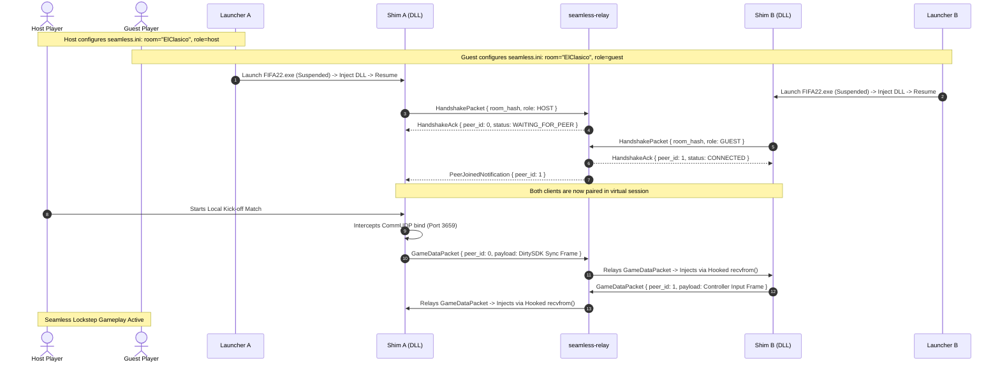

# Seamless FIFA 22: High-Level Architecture Specification

## 1. Executive Summary

We are officially pivoting the **FIFA 22 Multiplayer Project** away from the legacy **Server Emulator** approach toward a **Seamless Co-op Architecture** (inspired by the proven methodology of mods such as *Elden Ring Seamless Co-op* by LukeYui).

Instead of attempting to recreate EA's proprietary cloud backend—which is encumbered by multi-stage TLS certificate validation, BoringSSL pinning, internal QoS UDP handshakes, and rigid Blaze component state machines—we take **direct control of the client's network transport layer**.

FIFA 22 already contains a complete, robust, lockstep peer-to-peer netcode engine (`DirtySDK CommUDP` / `NetGameDist`) used for online friendlies, co-op seasons, and kick-off matches. By intercepting these low-level UDP packets directly at the socket boundary, encapsulating them with our custom envelope protocol, and relaying them through our lightweight Rust server (`seamless-relay`), two players can connect and play seamlessly with zero EA server interaction.

---

## 2. Comparison: Server Emulator vs. Seamless Co-op

| Dimension | Legacy Server Emulator Approach | Seamless Co-op Architecture |
|---|---|---|
| **Core Concept** | Emulate EA Cloud (Redirector, Blaze, QoS, Telemetry, GOSCA) | Intercept & relay local game netcode (`CommUDP`) directly between clients |
| **Authentication & TLS** | Requires patching 5+ root CA tables, BoringSSL pinning, self-signed TLS certs, and certificate revocation lists | **Zero TLS required**. Game traffic is routed over clean UDP envelopes |
| **EA Backend Dependency** | High. Must emulate dozens of Blaze components (`Authentication`, `Util`, `CensusData`, `AssociationList`, `League`, `UserSessions`) | **Zero**. Game runs in offline exhibition / kickoff mode; network is hijacked under the hood |
| **QoS / Ping Checks** | Strict schema validation (`qosip` u32 vs string, hostnames, SNI mismatch aborts) | Completely bypassed. Custom ping and RTT telemetry handled directly by our relay |
| **Maintenance Burden** | High. Fragile XML schemas, reverse-engineering proprietary EA Blaze TDF binary formats | Minimal. Raw game simulation frames are treated as opaque payloads |
| **Latency & Performance** | Dependent on multi-hop emulation stack and TLS handshake latency | Sub-millisecond packet forwarding, optional direct P2P NAT punch-through |
| **Stability** | Prone to crashes on XML parser mismatches, socket option conflicts, and state desync | Native stability. The Frostbite game engine uses its native P2P simulation |

---

## 3. High-Level System Architecture Diagram

```mermaid
flowchart TD
    subgraph ClientA ["Host Machine (Client A)"]
        LauncherA["FIFA22_Seamless.exe"] -->|1. CreateProcess Suspended & Inject| FIFA22_A["FIFA22.exe (Frostbite Engine)"]
        FIFA22_A -->|2. Internal CommUDP Socket| ShimA["seamless_fifa.dll (Winsock Hooks)"]
        ShimA -->|3. Intercept & Wrap Envelope| NetA["WinSock sendto()"]
    end

    subgraph Infrastructure ["Seamless Relay Infrastructure"]
        Relay["seamless-relay Server (:42000 UDP)\n(Tokio Rust Engine)"]
        STUN["P2P STUN / Hole Punch Resolver"]
    end

    subgraph ClientB ["Guest Machine (Client B)"]
        LauncherB["FIFA22_Seamless.exe"] -->|1. CreateProcess Suspended & Inject| FIFA22_B["FIFA22.exe (Frostbite Engine)"]
        FIFA22_B -->|2. Internal CommUDP Socket| ShimB["seamless_fifa.dll (Winsock Hooks)"]
        ShimB -->|3. Intercept & Wrap Envelope| NetB["WinSock sendto()"]
    end

    NetA -->|Encapsulated UDP Packets\nRoom Token: BLAKE3(Password)| Relay
    Relay -->|Routed Game Packets| NetB
    NetB -->|Encapsulated UDP Packets| Relay
    Relay -->|Routed Game Packets| NetA

    ShimA <.->|Direct P2P UDP\n(If NAT allows)| ShimB
```

---

## 4. End-to-End Lifecycle & Execution Flow



---

## 5. Core Subsystems

### 5.1. Launcher (`FIFA22_Seamless.exe`)
* Standalone executable written in Rust or modern C++.
* Reads `seamless.ini` (server address, port, room password, display settings).
* Launches `FIFA22.exe` in a suspended state using Windows API `CreateProcessW`.
* Injects `seamless_fifa.dll` before the game can execute its entry point or initialize anti-tamper.
* Resumes the main thread to ensure clean hooking.

### 5.2. Client Shim (`seamless_fifa.dll`)
* Injected into `FIFA22.exe`.
* Hooks WinSock 2 functions: `socket`, `bind`, `sendto`, `recvfrom`, `WSASendTo`, `WSARecvFrom`, `select`, `ioctlsocket`.
* Traps DirtySDK socket allocations and binds to identify the active `CommUDP` socket (local port 3659).
* Replaces destination addresses: instead of dialing EA servers or arbitrary public IPs, all game UDP frames are encapsulated and sent to the relay server.
* Decapsulates incoming packets received from the relay server and feeds them back into DirtySDK as if they arrived directly from the remote opponent.
* Drops EA telemetry, crash reporting, and cloud telemetry silently (`river.data.ea.com`, `pin-river.data.ea.com`).
* Renders a lightweight in-game DirectX 12 overlay (Dear ImGui) showing connection state, latency (RTT), packet loss, and room code.

### 5.3. Relay Server (`crates/seamless-relay`)
* High-performance asynchronous UDP server built with Rust and Tokio.
* Stateless packet forwarding with room-based multiplexing:
  * Room hash derived from shared password using `BLAKE3`.
  * Maintains an in-memory session table pairing Host (Peer 0) and Guest (Peer 1).
  * Verifies packet HMAC/header tokens to prevent spoofing or unauthorized injection.
  * Measures round-trip time (RTT) and jitter.
* Optional STUN / NAT traversal helper allowing clients to punch holes and upgrade from relay to direct peer-to-peer if network conditions permit.

---

## 6. Implementation Roadmap

1. **Phase 1: Architecture & Specifications (Current)**
   - Complete architectural plans, network hooking specification, relay server specification, and launcher design.
2. **Phase 2: Minimal Relay Server (`crates/seamless-relay`)**
   - Implement Tokio UDP server, room registry, envelope encoding/decoding, and integration tests.
3. **Phase 3: Client Shim (`seamless_fifa.dll`)**
   - Implement Winsock hooks (`sendto`, `recvfrom`, `bind`), envelope packaging, and telemetry drops.
4. **Phase 4: Launcher (`FIFA22_Seamless.exe`)**
   - Implement process creation, remote thread injection, and `seamless.ini` configuration parser.
5. **Phase 5: In-Game Verification & End-to-End Playtesting**
   - Test room pairing, packet delivery latency, match kickoff lockstep synchronization, and overlay telemetry.
