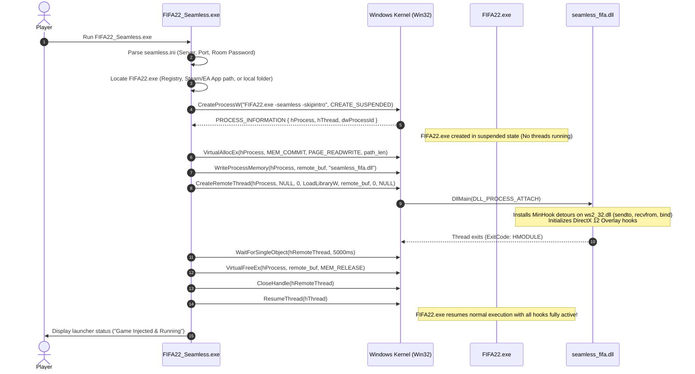

# Seamless FIFA 22: Launcher Design Specification (`FIFA22_Seamless.exe`)

## 1. Overview & Objectives

The **Seamless FIFA 22 Launcher** (`FIFA22_Seamless.exe`) is the dedicated entry-point utility for players running FIFA 22 in Seamless Co-op mode.

To ensure our custom networking shim (`seamless_fifa.dll`) is injected and initialized **before** the Frostbite 3 engine, DirtySDK, or game security threads initialize, the launcher uses **suspended process creation and early remote thread DLL injection**.

---

## 2. Process Lifecycle & Injection Sequence



---

## 3. Step-by-Step Win32 Implementation Details

### 3.1. Process Creation with Arguments
The launcher builds the target command line with dedicated flags to suppress intro movies, bypass redundant network checks, and pass the `-seamless` environment marker:

```cpp
std::wstring exe_path = L"FIFA22.exe";
std::wstring cmd_line = L"\"" + exe_path + L"\" -seamless -skipintro -novid -offline";

STARTUPINFOW si{};
si.cb = sizeof(si);
PROCESS_INFORMATION pi{};

BOOL created = CreateProcessW(
    exe_path.c_str(),
    const_cast<wchar_t*>(cmd_line.c_str()),
    nullptr,
    nullptr,
    FALSE,
    CREATE_SUSPENDED | NORMAL_PRIORITY_CLASS,
    nullptr,
    nullptr,
    &si,
    &pi
);
```

### 3.2. Remote Injection via `LoadLibraryW`
Because the process is suspended at the very start of its NT execution, no game threads have executed yet. This guarantees that:
1. `ws2_32.dll` function pointers are hooked before DirtySDK calls `WSAStartup()`.
2. DirectX 12 / DXGI factory pointers can be intercepted cleanly.
3. Anti-tamper routines cannot detect hooks mid-execution.

```cpp
// 1. Allocate buffer in suspended target process
size_t path_bytes = (wcslen(dll_full_path) + 1) * sizeof(wchar_t);
LPVOID remote_mem = VirtualAllocEx(pi.hProcess, nullptr, path_bytes, MEM_COMMIT | MEM_RESERVE, PAGE_READWRITE);

// 2. Write absolute path of seamless_fifa.dll
WriteProcessMemory(pi.hProcess, remote_mem, dll_full_path, path_bytes, nullptr);

// 3. Find address of LoadLibraryW in kernel32.dll
HMODULE hKernel32 = GetModuleHandleW(L"kernel32.dll");
FARPROC pLoadLibraryW = GetProcAddress(hKernel32, "LoadLibraryW");

// 4. Execute remote thread
HANDLE hThread = CreateRemoteThread(
    pi.hProcess,
    nullptr,
    0,
    reinterpret_cast<LPTHREAD_START_ROUTINE>(pLoadLibraryW),
    remote_mem,
    0,
    nullptr
);

// 5. Wait for DllMain completion
WaitForSingleObject(hThread, 5000);
CloseHandle(hThread);

// 6. Clean up remote memory
VirtualFreeEx(pi.hProcess, remote_mem, 0, MEM_RELEASE);

// 7. Resume the game
ResumeThread(pi.hThread);
CloseHandle(pi.hThread);
CloseHandle(pi.hProcess);
```

---

## 4. Configuration Schema (`seamless.ini`)

The launcher and the injected DLL both read from a single, transparent configuration file located in the game folder: `seamless.ini`.

```ini
[Seamless]
; Enable or disable seamless co-op features
enabled = true

; Relay server connection settings
relay_host = "127.0.0.1"
relay_port = 42000

; Shared secret session password for room pairing
; Both players MUST have the exact same password to join each other
session_password = "ElClasicoMatch2026"

; Role: 'host' (starts the match room) or 'guest' (connects to the host's room)
role = "host"

; Network settings
prefer_p2p = true
p2p_probe_timeout_ms = 1500
heartbeat_interval_ms = 1000

[Overlay]
; In-game status HUD (DirectX 12 Dear ImGui)
enabled = true
toggle_key = "F11"
gamepad_toggle_combo = "LB+RB+BACK"
show_rtt = true
show_packet_loss = true
position = "top_left"

[Logging]
; Diagnostic logging level: trace, debug, info, warn, error
log_level = "info"
log_to_file = true
log_file = "seamless_fifa.log"
```

---

## 5. Fallback Injection Modes

In addition to launching the game suspended, `FIFA22_Seamless.exe` supports two alternative operation modes:

1. **Proxy DLL Mode (`dxgi.dll` / `dinput8.dll`)**:
   - If the player prefers launching FIFA 22 through Steam or the EA Desktop App directly, the launcher can copy `seamless_fifa.dll` as `dxgi.dll` in the game folder.
   - When `FIFA22.exe` boots, the Windows PE loader loads `dxgi.dll` automatically before game initialization.
2. **CLI Daemon Mode**:
   - For dedicated server or headless relay operations, `FIFA22_Seamless.exe --relay` can launch the built-in relay service in the background.

---

## 6. User Experience & In-Game Overlay

Once injected, `seamless_fifa.dll` renders a minimal, non-intrusive status widget in the top corner of the screen:

* **Connected State**: Green indicator showing `SEAMLESS CO-OP: CONNECTED`.
* **Peer Info**: Shows remote player username and role (`Host` or `Guest`).
* **Telemetry**: Real-time Round Trip Time (e.g. `Ping: 18ms`) and Packet Loss rate.
* **Match Status**: Displays `LOCKSTEP: SYNCED` when the DirtySDK match frame loop is active.
