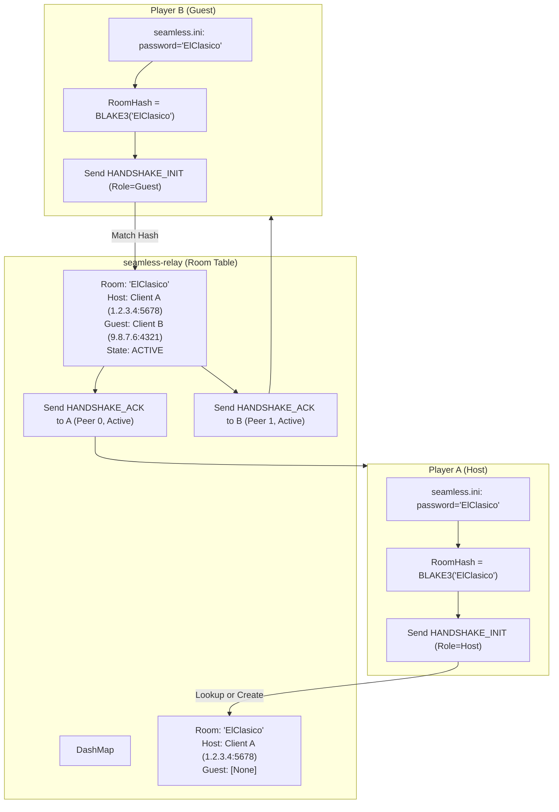

# Seamless FIFA 22: Relay Server Specification (`seamless-relay`)

## 1. Overview & Architecture

The **Seamless Relay Server** (`crates/seamless-relay`) is a dedicated, ultra-low-latency asynchronous UDP routing service written in Rust using Tokio. Its primary responsibility is to act as a rendezvous point and transparent packet relay for two FIFA 22 clients executing in Seamless Co-op mode.

The server operates without any database, complex accounts, or heavy protocol handshakes. Matchmaking is fully decentralized and governed by **Room Passwords**.

---

## 2. Server Design Goals
1. **Ultra-Low Latency Overhead**: Sub-millisecond forwarding time ($< 0.5\text{ ms}$ processing budget per packet).
2. **Zero In-Flight Heap Allocations**: Reusable buffer pools for packet receiving and forwarding.
3. **Decentralized Password Matchmaking**: No lobbies or external matchmaker needed; matching is driven by cryptographic hash consensus.
4. **Resilience & NAT Traversal**: Transparent fallback between direct P2P hole-punching and relay mode without dropping in-progress frames.
5. **Stateful Session Lifecycle with Idle Cleanup**: Automatic pruning of stale or disconnected match rooms.

---

## 3. Protocol Binary Specification

All communication between `seamless_fifa.dll` and `seamless-relay` occurs over UDP using binary frames packed in Big-Endian (Network Byte Order).

### 3.1. Envelope Header Layout (44 Bytes Total)

| Byte Offset | Field Name | Data Type | Description |
|---|---|---|---|
| `0x00 .. 0x03` | `magic` | `[u8; 4]` | Protocol magic identifier: `0x53 0x46 0x32 0x32` (`"SF22"`) |
| `0x04` | `version` | `u8` | Protocol version (current: `0x01`) |
| `0x05` | `msg_type` | `u8` | Message type opcode (see table below) |
| `0x06` | `peer_id` | `u8` | Peer index within room: `0` (Host), `1` (Guest), `0xFF` (Unassigned) |
| `0x07` | `flags` | `u8` | Bitflags: `0x01` = Compression, `0x02` = P2P Probe, `0x04` = Relayed |
| `0x08 .. 0x27` | `room_hash` | `[u8; 32]` | 256-bit BLAKE3 hash of the shared session password |
| `0x28 .. 0x2B` | `seq_num` | `u32` | Monotonically increasing sequence number for jitter tracking |
| `0x2C .. 0x2D` | `payload_len` | `u16` | Length of inner DirtySDK payload ($0 \le N \le 1400$) |
| `0x2E ..` | `payload` | `[u8; N]` | Raw game data (untouched DirtySDK frame) |

### 3.2. Message Type Opcodes (`msg_type`)

| Opcode | Identifier | Direction | Purpose |
|---|---|---|---|
| `0x01` | `HANDSHAKE_INIT` | Client $\to$ Server | Client announces presence and presents `room_hash` and requested role. |
| `0x02` | `HANDSHAKE_ACK` | Server $\to$ Client | Server confirms registration, assigns `peer_id`, and reports room status. |
| `0x03` | `GAME_DATA` | Client $\to$ Server $\to$ Client | Encapsulated Frostbite / DirtySDK CommUDP packet. |
| `0x04` | `HEARTBEAT_PING` | Client $\to$ Server | Keepalive ping and round-trip time (RTT) calculation probe. |
| `0x05` | `HEARTBEAT_PONG` | Server $\to$ Client | Echoed timestamp for client RTT calculation. |
| `0x06` | `PEER_STATUS_NOTIFY` | Server $\to$ Client | Broadcast notification when remote peer joins, leaves, or times out. |
| `0x07` | `DISCONNECT` | Client $\to$ Server | Clean session teardown on match exit. |

---

## 4. Matchmaking & Room Pairing Mechanism

Matchmaking requires no server UI, no matchmaking queues, and no central lobby database.



### 4.1. Room Lifecycle
1. **Creation**: When the first client contacts the server with a given `room_hash`, the server instantiates an active `RoomState` containing:
   - `created_at`: Unix timestamp.
   - `last_activity`: Timestamp updated on every received packet.
   - `peers[0]`: Public socket address (`SocketAddr`) of Peer 0 (Host).
   - `peers[1]`: Public socket address (`SocketAddr`) of Peer 1 (Guest).
2. **Pairing**: When the second client sends a matching `room_hash`, the room transitions from `WaitingForGuest` to `Active`. The server immediately transmits `PEER_STATUS_NOTIFY(Status::Connected)` to both clients.
3. **Data Relaying**:
   - Packets arriving from `peers[0]`'s `SocketAddr` with `msg_type = GAME_DATA` are immediately routed to `peers[1]`'s `SocketAddr`.
   - Packets arriving from `peers[1]`'s `SocketAddr` with `msg_type = GAME_DATA` are immediately routed to `peers[0]`'s `SocketAddr`.
4. **Heartbeats & Expiration**:
   - Clients send a `HEARTBEAT_PING` every 1.0 second during idle periods.
   - If no packets are received from either peer for 30 seconds, the room is deleted from the `DashMap` to free memory.

---

## 5. Direct P2P Hole-Punching (Optional Upgrade)

While the relay guarantees $100\%$ connectivity even behind strict symmetric firewalls, direct peer-to-peer (P2P) communication provides the absolute lowest latency.

1. **Endpoint Exchange**:
   - Once both peers are paired in an active room, the server issues a `P2P_PROBE` containing each peer's observed public `SocketAddr`.
2. **Simultaneous UDP Punching**:
   - Both clients begin sending periodic lightweight probe packets directly to each other's public endpoints.
3. **Seamless Transition**:
   - If Client A receives a direct probe packet from Client B, both clients notify their local shims.
   - Game packets switch to direct transmission without dropping frames or interrupting lockstep execution.
   - If direct packets are lost or dropped for $> 1.0\text{ second}$, the shims automatically revert to server relay mode.

---

## 6. Rust Data Structures & Concurrency Model

```rust
use std::net::SocketAddr;
use std::time::Instant;
use dashmap::DashMap;

pub type RoomHash = [u8; 32];

pub struct PeerInfo {
    pub addr: SocketAddr,
    pub peer_id: u8,
    pub last_seen: Instant,
    pub rtt_ms: u32,
    pub packets_relayed: u64,
}

pub struct RoomSession {
    pub room_hash: RoomHash,
    pub created_at: Instant,
    pub last_activity: Instant,
    pub host: Option<PeerInfo>,
    pub guest: Option<PeerInfo>,
}

pub struct RelayState {
    pub rooms: DashMap<RoomHash, RoomSession>,
}
```

The relay uses Tokio's multi-threaded runtime with an asynchronous UDP socket (`tokio::net::UdpSocket`). All room operations use `DashMap` for concurrent, lock-free lookups across all worker threads.
